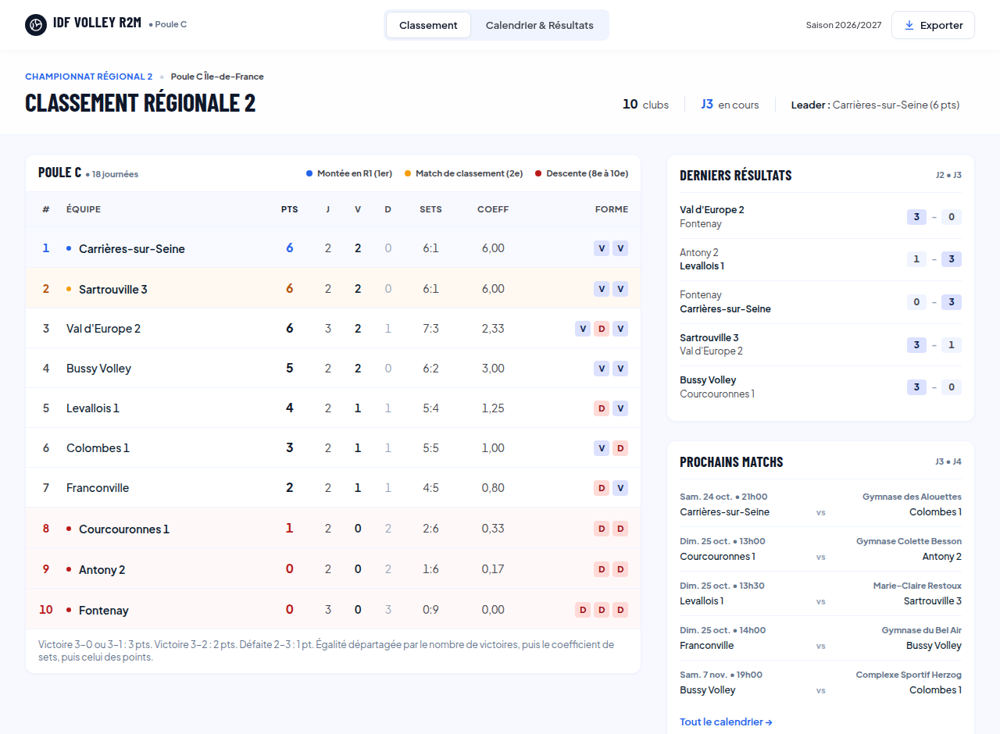
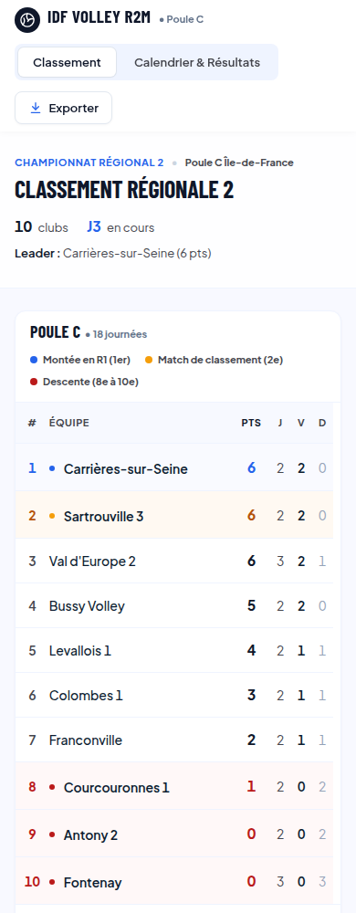

# Classement de volley-ball : Régionale 2 masculine, poule C


Site web réalisé avec **Flask** qui affiche le classement, le calendrier et les résultats d'un
vrai championnat de volley-ball : la Régionale 2 senior masculine (poule C) de la Ligue
Île-de-France, saison 2026/2027. C'est une version moderne et adaptée au téléphone de la page
officielle publiée par la fédération.





## Fonctionnalités

- **Classement** calculé automatiquement à partir des résultats : points, victoires, défaites,
  sets, coefficients et forme récente (5 derniers matchs)
- **Calendrier** des 18 journées, filtrable par équipe
- **Fiche de chaque équipe** : rang, statistiques, matchs joués et à venir
- **Import automatique des résultats** depuis la page de la fédération, avec contrôle de la
  qualité des données avant tout enregistrement
- **Saisie manuelle des résultats** set par set, protégée par un mot de passe, avec vérification
  des règles du volley (un score impossible comme 25-24 est refusé)
- **Export du classement** au format CSV, qui s'ouvre directement dans Excel (bouton « Exporter »)
- Design adapté au téléphone, construit à partir d'une maquette et de son design system
  (polices Barlow Condensed et Plus Jakarta Sans, palette marine, cobalt et ambre)

## Lancer le site

Il faut Python 3.9 ou plus récent.

Sous Windows (PowerShell) :

```powershell
python -m venv .venv
Set-ExecutionPolicy -Scope Process -ExecutionPolicy Bypass   # autorise l'activation dans cette fenêtre
.venv\Scripts\Activate.ps1
pip install -r requirements.txt
python app.py
```

Sous macOS ou Linux :

```bash
python3 -m venv .venv
source .venv/bin/activate
pip install -r requirements.txt
python app.py
```

Ouvrez ensuite <http://127.0.0.1:5000>. Au premier lancement, la base de données `volley.db`
est créée automatiquement à partir du fichier `data/poule_R2M_C_2026-2027.json`.

Pour remettre la base à zéro : `flask --app app init-db`.

### Réglages

Deux réglages se font par variables d'environnement :

| Variable | Rôle | Valeur par défaut |
|---|---|---|
| `ADMIN_PASSWORD` | Mot de passe demandé pour saisir un résultat | `volley` (à changer avant toute mise en ligne) |
| `EQUIPE_SUIVIE` | Équipe surlignée dans le classement, par exemple `BUSSY` | aucune |

Les textes de l'en-tête (`SITE_NOM`, `SITE_POULE`...) et le nombre d'équipes dans chaque zone du
classement (`ZONE_ACCESSION`, `ZONE_BARRAGE`, `ZONE_RELEGATION`) se règlent au début de `app.py`.

Sous Windows (PowerShell) : `$env:EQUIPE_SUIVIE="BUSSY"`, puis `python app.py`.
Sous macOS ou Linux : `EQUIPE_SUIVIE=BUSSY python app.py`.

## Mettre à jour les résultats

Après chaque week-end de matchs, une seule commande récupère les nouveaux résultats sur la page
de la fédération :

```bash
flask --app app importer --simulation   # affiche ce qui changerait, sans rien modifier
flask --app app importer                # enregistre les changements
```

Le script fonctionne comme un petit pipeline de données :

1. **Extraire** : il télécharge la page de la poule, en une seule requête.
2. **Transformer** : il y retrouve, pour chaque match, la date, l'heure et les scores des sets.
3. **Charger** : il compare avec la base et n'enregistre que ce qui a changé (nouveaux résultats,
   corrections, matchs reprogrammés).

Avant d'enregistrer un résultat, il vérifie que les deux équipes correspondent bien au match,
que le score respecte les règles du volley et que le total des points affiché est cohérent avec
les sets. Un résultat douteux n'est jamais enregistré : il est signalé dans le compte rendu.

## Organisation du code

```
app.py          routes Flask : une fonction par page
db.py           accès à la base SQLite : création, requêtes SQL, enregistrement
importer.py     import automatique des résultats depuis le site de la fédération
volley.py       règles du volley et calcul du classement (sans Flask ni base de données)
schema.sql      structure de la base
data/           résultats de la poule au format JSON
templates/      pages HTML (Jinja)
static/         feuille de style CSS
tests/          tests automatiques (pytest)
```

Le calcul du classement est volontairement séparé de Flask et de la base de données : le
fichier `volley.py` ne manipule que des listes Python, ce qui le rend simple à tester.

## Base de données

Trois tables reliées entre elles :

- `equipes` : identifiant, nom officiel, nom affiché, site du club ;
- `matchs` : code officiel, journée, date, heure, gymnase, équipe à domicile et à l'extérieur
  (clés étrangères vers `equipes`) ;
- `sets` : les points de chaque set d'un match (clé étrangère vers `matchs`). Un match non
  joué n'a aucune ligne dans cette table.

## Règles appliquées

Un match se joue en 3 sets gagnants. Un set se gagne à 25 points (15 au 5e set), avec
2 points d'écart.

| Résultat | Points du vainqueur | Points du perdant |
|---|---|---|
| 3-0 ou 3-1 | 3 | 0 |
| 3-2 | 2 | 1 |

En cas d'égalité de points, les équipes sont départagées par le nombre de victoires, puis par le
coefficient de sets (sets gagnés / sets perdus), puis par le coefficient de points (points
marqués / points encaissés).

En fin de saison, le 1er de la poule monte en Régionale 1, le 2e dispute un match de classement
pour une éventuelle montée supplémentaire, et les 8e, 9e et 10e descendent en Accession Régionale.
Le site affiche ces zones en couleur.

Ces règles viennent du
[règlement de la Régionale 2 masculine 2026/2027](https://www.volleyidf.org/wp-content/uploads/2026/09/RPE-Regionale-2-Masculine-2026-2027.pdf)
de la Ligue Île-de-France (articles 13 et 14). Ne sont pas encore gérés : les points retirés en cas
de pénalité (-1) ou de forfait (-3), et le départage par les confrontations directes.

## Tests

```bash
pip install -r requirements-dev.txt
pytest
```

47 tests vérifient les règles des sets et des matchs, les pages du site, la saisie des
résultats, l'export CSV et l'import automatique. L'un d'eux compare le classement calculé par le site au **classement officiel
publié par la fédération le 23 octobre 2026** : les deux sont identiques, équipe par équipe.
GitHub Actions relance les tests à chaque modification.

## Données

Les équipes, le calendrier et les premiers résultats proviennent de la
[page publique de la poule](https://www.ffvbbeach.org/ffvbapp/resu/vbspo_calendrier.php?saison=2026/2027&codent=LIIDF&poule=2MC)
sur le site de la FFvolley, relevée le 23 octobre 2026. Les noms des arbitres n'ont pas été
repris. Les résultats suivants sont récupérés avec l'import automatique, ou saisis à la main.

Projet personnel non officiel, sans lien avec la FFvolley ni avec la Ligue Île-de-France.

## Pistes d'amélioration

- Lancer l'import automatiquement chaque lundi (planificateur de tâches Windows ou cron)
- Afficher un graphique de l'évolution du classement journée après journée
- Gérer les forfaits et plusieurs poules
- Remplacer le mot de passe par une vraie connexion administrateur
- Mettre le site en ligne (PythonAnywhere ou Render, par exemple)
